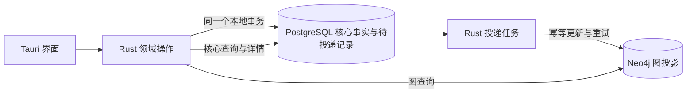

# 个人知识图谱：Neo4j 与 PostgreSQL 双库分工研究

核验日期：2026-11-07（Asia/Shanghai）。本文应用 research 技能，以 PostgreSQL、Neo4j、Docker、微软和 Debezium 官方资料核验相关能力与模式。本文提出技术候选，不代表分工、可见延迟、恢复方式或实现范围已得到用户确认；未安装、部署、编写原型或修改其他项目文件。

## 1. 结论

用户已确认讨论对象是 **Tauri＋Neo4j**，希望同时采用 PostgreSQL，并明确愿意自行安装配置和使用 Docker。用户本人已接受数据库与 Docker 配置，未来普通开源使用者的最终交付方式仍未确定。学习和使用图数据库是正当目标；是否采用双库不能只按当前个人数据量判断。

**建议优先比较“PostgreSQL 保存全部核心事实，Neo4j 保存可重建的图查询投影”。** PostgreSQL 统一保存知识点及其 `description`、知识关系、资料信息、资料关联、必要导入记录以及回收站／恢复所需状态；上传文件本体仍需单独选择存放方式。Neo4j 根据这些事实生成节点和关系，用 Cypher 提供图查询与探索。这个建议让 Neo4j 有实际职责，同时将需要共同判断的业务状态保留在一个事务范围内。

这是一项结合项目约束的架构推断，不是数据库厂商为本项目背书。代价是要实现可靠的投影更新，且图可能短暂落后于已保存数据；若用户希望 Neo4j 本身主存和管理知识点、关系，而非接收投影，另一种分工也可成立，但跨库恢复和引用一致性需要更明确的规则。

本报告仅比较这两种双库分工，并保留 Neo4j 单库与 PostgreSQL 单库作为可解释的替代方向；不劝回 SQLite，不引入第三种数据库、向量库、Kafka 或独立 CDC 服务。

## 2. 已确认业务约束及本轮不能决定的内容

已重新读取 [spec.md](../spec.md) 和 [CONTEXT.md](../../../CONTEXT.md)：

- 一个知识点可以同时属于多个主题，仍共用一个节点及其资料关联；当前知识关系先支持“所属主题”，不作 MVP 或版本排期。
- 解释文字是知识点的 `description` 属性，随节点保存、删除和恢复，不建立独立解释资料对象。
- 名称不同按不同知识点处理，不做自动同义识别、改名推断或跨名称智能归并；同名异义由用户显式名称与结构区分。
- 导入累积补充、输入缺失不删等简单规则保留为背景；导入导出与备份恢复细节暂缓讨论。
- 搜索覆盖知识点名称与 `description`，描述命中也应返回该知识点；结果显示名称与一小段描述摘要。
- 删除主题时保留仍归属其他保留主题的共享知识点；因本次删除失去全部主题的受影响下属知识点按已确认方向移除；不推广为全局无引用清理。
- 删除支持回收站和恢复；上传文件本体先保留。
- 日常查看与手动维护流程继续讨论；回收站保留与恢复交互后续确定。不能沿用旧研究中的独立文本资料清理或智能同义识别问题。

以下出现的“删除事件”“墓碑”“版本”都是同步技术概念。它们只传播已经由业务规则决定的结果，不重新解释级联范围，也不决定用户数据何时彻底删除。此处不确定表结构、节点标签、关系 schema、名称唯一性或具体删除语句。

## 3. 两个本地事务不构成一个跨库事务

PostgreSQL 的 `BEGIN`／`COMMIT` 将相应 SQL 操作包在一个数据库事务内；Neo4j 也提供自己的事务及 Query API 显式提交／回滚能力。先提交 PostgreSQL、再提交 Neo4j，或把这个顺序倒过来，都存在第一库成功后进程中断、第二库没有完成的窗口。[PostgreSQL BEGIN](https://www.postgresql.org/docs/current/sql-begin.html)、[Neo4j transactions](https://neo4j.com/docs/operations-manual/current/database-internals/transaction-management/)、[Neo4j Query API transactions](https://neo4j.com/docs/query-api/current/transactions/)。

这是从两个独立事务边界得出的推断，不表示所有数据库组合都绝无分布式事务方案。PostgreSQL 官方另有面向外部事务管理器的两阶段事务机制；仅仅支持该机制，不证明它与当前 Neo4j Query API 已自动组成全局事务，本项目也没有提出相应协调器。[PostgreSQL two-phase transactions](https://www.postgresql.org/docs/current/two-phase.html)。

Docker Compose 可以组织两个数据库进程和持久化配置，`depends_on`／`service_healthy` 可以控制启动依赖及健康就绪条件；它不把两库写入、备份或恢复变成一个原子操作。程序仍要处理运行中的连接中断与重试，不能只检查启动顺序。[Compose startup order](https://docs.docker.com/compose/how-tos/startup-order/)。

## 4. 候选 A：PostgreSQL 是事实源，Neo4j 是可重建图投影

### 4.1 职责与操作路径

图为推荐候选，不是已实现架构。PostgreSQL 需要保留重建目标图所需的完整信息，包括知识点、`description` 与所属主题关系；不能把关系唯一副本留在 Neo4j，同时声称它可从 PostgreSQL 重建。Neo4j 存放图查询需要的节点、边和必要投影属性，不必复制全部资料内容、导入详情或回收站内部结构。`description` 是否进入图投影，取决于图查询所需属性，不改变它是知识点属性的业务定义。

用户的导入、编辑、删除与恢复先由 Rust 领域逻辑根据业务规则处理，写入 PostgreSQL；图投影任务只落实处理结果。若允许直接在 Neo4j Browser 中修改正式图，这些修改不会自动成为 PostgreSQL 事实，之后重建可能丢失。因此该路线需要用户接受：正式修改经应用处理，Neo4j 的 Cypher 探索以查询为主；若图中产生新的正式知识，应先定义回到事实源的写入流程。

搜索名称、`description` 及查看详情可由 PostgreSQL 支持，图探索由 Neo4j 提供，是本项目职责划分建议。具体中文匹配、排序、查询组件和失败时界面行为仍待确认，不因双库而默认引入双重全文索引。

### 4.2 为什么采用事务 outbox

推荐候选是在保存业务变化的**同一个 PostgreSQL 事务**中，同时保存“哪些图投影需要更新”的持久记录，提交后由 Rust 投递任务读取并更新 Neo4j。微软官方 outbox 资料将“业务状态和事件记录在同一本地事务中保存”作为模式核心；PostgreSQL 的本地事务能力可用于实现这一点。[Microsoft transactional outbox](https://learn.microsoft.com/en-us/power-platform/architecture/reference-architectures/transactional-outbox-pattern)、[Microsoft atomic event log example](https://learn.microsoft.com/en-us/dotnet/architecture/microservices/multi-container-microservice-net-applications/subscribe-events)、[PostgreSQL BEGIN](https://www.postgresql.org/docs/current/sql-begin.html)。

这里借用的是模式，**不引入 Dataverse、Azure、Debezium、Kafka 或消息代理**。用 Rust 后台任务轮询 PostgreSQL 待投递记录，是本项目的简化推断，不是这些官方示例提供的现成 Rust 实现。任务可在应用生命周期内运行，也可作为独立进程运行；是否需要程序关闭后继续同步，尚未决定，不能先把它变成第三个常驻服务。

Outbox 的价值是避免“业务已经保存，但内存中的投递任务随崩溃丢失”。它不让 PostgreSQL 和 Neo4j 同时提交，也不等于完整事件溯源系统：事实源可以保存当前业务状态，投递记录按后续保留策略管理；全量重建可以读取完整当前状态，不要求永久保留全部历史事件。

### 4.3 投递正确性需要哪些约束

| 情形 | 推荐处理原则 | 边界 |
| --- | --- | --- |
| PostgreSQL 事务回滚 | 业务变化与待投递记录一起回滚 | 不应仅靠事务提交前发起网络请求通知 Neo4j |
| PostgreSQL 已提交，Neo4j 不可用 | 记录保持待处理，恢复连接后继续投递 | “已经保存”与“图已更新”是两个状态，具体展示需用户确认 |
| Neo4j 已提交，确认投递状态前崩溃 | 允许重试相同消息，并确保重复不会创建额外节点、边或重复执行业务效果 | 实际上应按可能重复投递设计，不宣称天然恰好一次 |
| 旧更新晚于新更新到达 | 按内部对象标识及状态版本／等效顺序机制阻止回退 | 不能仅用到达时间决定采用顺序 |
| 删除后旧更新重试 | 删除信息及其版本必须仍可判断，旧消息不能让对象或关系复活 | 同步墓碑不等于业务彻底删除；恢复也须能区分新的有效状态 |
| 某条消息一直失败 | 持久记录原因，提供重试或修复途径，避免悄悄丢弃 | 不在此处增加面向用户的复杂队列管理界面 |

这些是由崩溃窗口及异步同步推导出的工程要求，不是产品已确认的字段设计。Debezium 官方 outbox 文档明确使用独立事件 ID 辅助去除重复消息；本文只借鉴这个原理，不复制其表结构或引入其连接器。[Debezium outbox event ID](https://debezium.io/documentation/reference/stable/transformations/outbox-event-router.html)。

内部稳定标识、事件标识和状态版本承担不同职责，不能仅用可编辑名称充当同步身份；这不引入智能同义归并，也不改变“不同名称按不同点处理”的已确认业务规则。节点、关系及删除状态都要考虑顺序，不能只给节点加版本而允许旧边重新连回已经删除的节点。可以比较“事件携带目标状态”与“事件通知后重新读取 PostgreSQL 最新目标状态”等实现，具体协议后续再定。

Neo4j 的投影更新应将对应检查和修改放在自己的事务范围内。Cypher `MERGE` 可用于匹配或创建，但不能把任意一条 `MERGE` 视为完整的并发幂等证明；官方区分节点唯一性约束和已绑定端点关系合并的锁行为。需要根据最终内部身份与投递并发方式验证，而不是按名称盲目合并。[Neo4j MERGE](https://neo4j.com/docs/cypher-manual/current/clauses/merge/)、[Neo4j Query API transactions](https://neo4j.com/docs/query-api/current/transactions/)。

如果图投影可重建，应用仍需考虑“投影处理到哪一批变化”的可观察状态、失败重试与版本升级。它们可以由本地任务完成，不等于必须引入企业级消息平台。异步读模型可能滞后，是官方 CQRS 模式列出的取舍；本候选借用读写模型分工，不把 CQRS 自动扩张成完整事件溯源架构。[Microsoft CQRS](https://learn.microsoft.com/en-us/azure/architecture/patterns/cqrs)。

### 4.4 可重建的架构含义

可重建应当有具体含义：给定一份完整、相互一致的 PostgreSQL 事实状态和对应投影规则，能够重新建立当前应出现的知识点、所属主题、资料关联及必要属性，并正确排除业务已移除的内容。回收站保留哪些对象及恢复哪些连接仍由业务规则决定，不能在重建中重新猜测。

用户已暂缓导入导出与备份恢复细节，本节只记录双库架构责任，不确定重建期间是否停写或未来恢复交互。无论采用暂停写入还是在线重建，实现时都要让完整状态与后续增量正确衔接，不能简单“先读表，再补最近事件”就宣称不会漏更新。

尤其不能未经证明就用自增 outbox 序号的最大值当作“所有更早事务已经提交”的界线。PostgreSQL 官方说明 sequence 变化不按事务回滚且对其他事务立即可见；据此，自增值并不是天然提交顺序，在线重建边界需要另行证明。[PostgreSQL transaction isolation and sequences](https://www.postgresql.org/docs/current/transaction-iso.html)。

从备份恢复 PostgreSQL 后，旧 Neo4j 可能领先、落后或属于另一恢复状态；不能直接信任旧投递确认状态宣称两库一致。推荐把恢复后的事实版本作为新的校准起点，按明确规则重建投影或做经验证的完整对账。投影代际、标记和清理方式是后续实现细节，不在本轮确定 schema。

该候选的完整业务备份重点是 PostgreSQL 与资料本体的匹配集合。Neo4j 的备份可以用于缩短恢复时间，但不是不可替代的唯一知识副本；若某份正式信息只存在于 Neo4j，该“可重建”前提就不成立。

## 5. 候选 B：Neo4j 主存知识点与边，PostgreSQL 主存资料与导入

这种分工让知识点、`description` 与关系由 Neo4j 主存和写入，PostgreSQL 保存资料元信息、必要导入记录及相应管理信息。它能满足希望深入使用图数据库的目标；并非因为当前规模较小就不合理。但职责划分把多项业务操作拆到两个事实源中。

例如新增知识点及其资料关联可能同时影响 Neo4j 与 PostgreSQL；主题删除可能要计算共享保留结果并记录回收站及可恢复连接；资料更新可能改变一个图对象的引用。两库各自事务不能自动把这些步骤一并提交，操作中断后需要识别部分完成并继续或补偿。补偿的业务含义也不能仅由数据库语法决定。[PostgreSQL transactions](https://www.postgresql.org/docs/current/sql-begin.html)、[Neo4j transactions](https://neo4j.com/docs/operations-manual/current/database-internals/transaction-management/)。

| 问题 | 此候选需要额外明确的责任 |
| --- | --- |
| 跨库引用 | 图中的资料标识与 PostgreSQL 记录如何保持对应；普通外键不能直接跨到另一个引擎检查 |
| 操作中断 | 哪个库记录总体操作状态，哪个库能判断待完成步骤；重试如何不重复创建 |
| 删除与回收站 | 节点、关系、资料及恢复信息分别由谁权威保存；怎样防止只恢复一半 |
| 对账 | 发现悬空引用、缺边或不匹配版本时，哪一边胜出，哪些内容可以重算 |
| 备份恢复 | 两个权威数据库必须恢复为对应状态，且资料本体引用仍然有效 |

表为本项目推断。可以通过持久操作状态、幂等步骤、重试及明确补偿设计实现，但这比“其中一个图库可由另一库重建”保留了更多跨库事实协调。采用 outbox 仍可能帮助可靠发起后续步骤，却不会把分散的两个业务事实源变成单库原子事务。

不能把“图归图数据库、文字归关系数据库”当作自动正确的唯一划分：这里最难的是共享删除、回收站恢复及关联维护等业务操作的完整性，而不是二进制文件或文字字段能否存入某个引擎。当前 `description` 明确属于知识点属性；候选 B 不把它拆回独立文本资料。

## 6. 备份与 Compose 的共同边界

Neo4j Community Edition 的官方完整 dump／load 路线要求 DBMS 离线；PostgreSQL 的 pg_dump 可在数据库并发使用时形成该数据库的一致导出。它们分别一致，不代表同一个业务时点，更不代表外部文件已经被保存。[Neo4j offline dump](https://neo4j.com/docs/operations-manual/current/backup-restore/offline-backup/)、[Neo4j dump restore](https://neo4j.com/docs/operations-manual/current/backup-restore/restore-dump/)、[PostgreSQL pg_dump](https://www.postgresql.org/docs/current/app-pgdump.html)。

在候选 A 中，可以以 PostgreSQL 业务备份为准恢复并重建 Neo4j，因此不要求两个独立 dump 天然对齐；仍须保证资料文件与 PostgreSQL 中引用匹配。候选 B 中两边都有不可重建的事实，需要停止相关写入与同步后取对应备份，或另行设计和验证恢复点协调；“同一次 Compose 命令启动”“同一时间运行两个备份命令”“两个卷在同一电脑”都不能证明业务一致。

用户愿意自行配置 Docker 解决了部署偏好问题；双库的持久数据和升级责任仍然存在。用户已暂缓备份恢复细节，本轮不继续展开备份路径、保留数量或恢复界面。本文不生成 Compose 文件、不规定端口和密码，也不执行部署。Docker 文档的启动健康条件属于进程就绪控制，不是数据库一致性协议。[Docker Compose startup dependencies](https://docs.docker.com/compose/how-tos/startup-order/)。

## 7. 两种双库路线与单库备选的取舍

| 路线 | 用户能实际学习和使用什么 | 主要工程代价 | 条件建议 |
| --- | --- | --- | --- |
| A：PostgreSQL 事实源＋Neo4j 图投影 | SQL 事务数据管理；Neo4j Cypher 图查询、模型和索引；投影同步 | outbox、投递幂等与版本、延迟及重建 | **本轮优先推荐**，前提是接受图投影职责及可说明的同步延迟 |
| B：Neo4j 主存图＋PostgreSQL 主存资料／导入 | 两类引擎都作为正式写入系统，深入图存储和资料管理 | 跨库引用、部分完成、补偿、双事实源备份恢复 | 若“图数据由 Neo4j 权威维护”是明确目标，可继续设计，不以规模否决 |
| Neo4j 单库 | 图模型和 Cypher 为中心，相关记录统一表达 | 一个事务域内设计资料与导入模型；附件仍需完整备份 | 有效替代，若双库同步不是希望学习的内容可比较 |
| PostgreSQL 单库 | SQL、关联及递归查询；图展示由应用完成 | 自行组织图逻辑和查询 | 有效替代，不要求退回嵌入式数据库 |

表中成本为架构判断，不是性能评测。Neo4j 的 Query API 支持以 HTTP 执行参数化 Cypher 和事务，可供 Rust 投递与查询逻辑采用；实际 Rust 接口选择及版本适配仍未确定。[Neo4j Query API](https://neo4j.com/docs/query-api/current/)、[Query parameters](https://neo4j.com/docs/query-api/current/query/)。

## 8. 应带回访谈的决定

1. 是否接受候选 A 的分工：PostgreSQL 保留全部核心事实，Neo4j 专门承担可重建图查询；还是明确希望采用候选 B，让 Neo4j 权威主存知识点和关系。
2. 若选 A，是否接受“保存成功后图稍后完成更新”；投影不可用时查询／编辑如何处理，以及是否要求程序关闭后仍继续同步。
3. 对正式数据直接执行 Cypher 修改的期望是什么；如果只修改投影会被重建覆盖，必须在职责确认时说清楚。

本轮应先确认分工与一致性取舍。具体 schema 和查询实现仍未决定；不重启已被暂缓的导入导出、备份恢复细节访谈，也不恢复已撤销的独立文本资料或自动同义判断分支。本报告不替用户决定日常操作流程，不创建 ADR。
