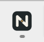
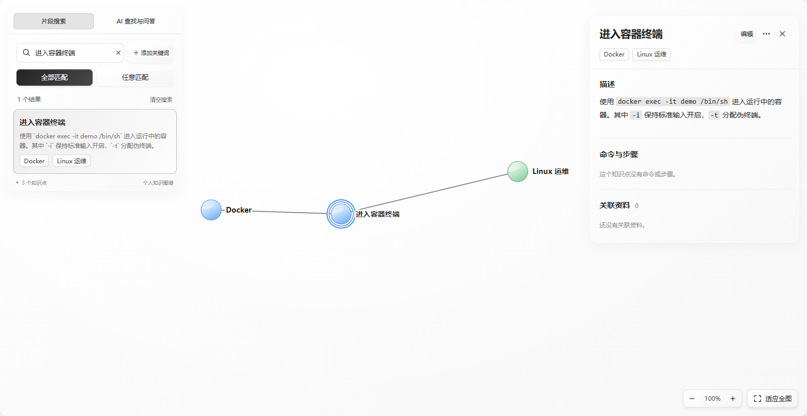

# Issue #25：公开下载包验收

验收日期：2026-11-13（Asia/Shanghai）。本记录承接 [首次实施验收](validation.md)，用于确认合并、公开发布后的真实分发包，而非以此前本地构建或 CI 候选包代替公开版本。

## 合并与公开版本

- [PR #28](https://github.com/jking412/Noterion/pull/28) 已合并到 `main`，合并提交：`6f44e447be776ac92ec6bc00c90eb19e956e13a1`。
- [Windows 发布流程 43381461493](https://github.com/jking412/Noterion/actions/runs/43381461493) 的 `check` 和 `release` job 均成功；包括正式构建、打包校验、解压程序 smoke，以及发布资产重新下载、校验、运行和公开下载验证。
- 公开预发布：[Noterion 0.1.0-main.6f44e447be77](https://github.com/jking412/Noterion/releases/tag/main-6f44e447be776ac92ec6bc00c90eb19e956e13a1)。公开时间为 **2026-11-13 15:01:43（Asia/Shanghai）**。它仍是 Windows x64 便携预发布，不是正式稳定版本或安装包。
- [公开 ZIP](https://github.com/jking412/Noterion/releases/download/main-6f44e447be776ac92ec6bc00c90eb19e956e13a1/Noterion-0.1.0-main.6f44e447be77-windows-x64.zip) 为 **4,583,514 字节**；ZIP SHA-256：`74dd5004e57736d6d402c7e7754fb5c50a657163a39b62d3ac26cc1c6313528b`。
- 包内 `noterion.exe` 为 **12,878,336 字节**；EXE SHA-256：`69b344ceb5e42cbb142ded353abe03dea7cc3fb6df326f26dc139ba560871a96`。

已在本任务专用 worktree 中**不带认证下载四个公开资产**：ZIP、`manifest.json`、`README.txt`、`SHA256SUMS`。每个文件与 GitHub 资产 digest 匹配，再用仓库 `release.mjs verify` 核对 SHA256SUMS、ZIP 三文件白名单、包内元数据、EXE 长度与 SHA-256、源提交和 release profile。发布的 [manifest 原件](public-release/manifest.json) 与 [脱敏验收结果](public-release/result.json) 已保留。

本轮仅更新中英文 README 与此公开包验收证据。应用代码、依赖和构建脚本没有新增修改；工作仍在原 #25 专用 worktree 内，文档分支为 `codex/issue-25-release-readme`。

## 对公开 EXE 的实际验证

| 范围 | 实际执行结果 |
| --- | --- |
| 启动与本地核心 | 嵌入式生产界面启动、真实 Rust 保存、完全退出后新进程重启检索，3 项全部通过，2 次启动。 |
| EXE 图标 | Windows PE 的 16/20/24/32/40/48/64/128/256px 九帧与正式 ICO 逐字节匹配；Windows 提取的 EXE 图标为新标志。 |
| 运行窗口与任务栏 | 核对指定 HWND 所属 EXE 路径，读取真实大、小图标；本机 150% 缩放下分别为 48px 和 256px。原生标题栏与实际任务栏均显示新标志。 |
| 前端标志与 favicon | 前端页眉实际显示同一标志；嵌入页面中的 SVG/PNG favicon 均返回 200、实际解码成功，512/32px 与构建资源哈希一致。 |
| 官方 AI 连接 | 由公开 EXE 连接 `https://api.deepseek.com`，使用 `deepseek-flash`，实际通过连接和结构化输出检查。 |
| 普通文本解析 | 真实模型将合成 Docker 学习文本整理成可核对候选，显示原文依据。 |
| 采用与持久化 | 通过真实界面整批采用；完全重启后仍能找到命令，且同一知识点同时属于 Docker、Linux 运维两个主题。 |
| 自然语言检索 | 问题不提供 `docker exec`，仍能找回实际已保存知识并跳转详情。 |
| 来源问答与追问 | 回答如何进入运行中的容器，说明 `-it` 的作用，提供实际知识来源并可跳回详情。 |
| 重复输入 | 完全相同文本返回已有采用结果，不重复创建知识。 |

官方 AI runner 的 **6 项断言全部通过**，包含设置入口与上述五条模型业务流程。完整结构化断言保留在 [public-release/result.json](public-release/result.json)。本轮没有以 HTTP 夹具、调试版或只看菜单来替代正式公开包的真实模型验收。

运行入口：

```powershell
node app/scripts/release.mjs verify --directory=app/smoke-output/public-release-6f44-01/download --commit=6f44e447be776ac92ec6bc00c90eb19e956e13a1 --extract=app/smoke-output/public-release-6f44-01/extracted
node app/scripts/release-smoke.mjs --exe=app/smoke-output/public-release-6f44-01/extracted/noterion.exe --driver=app/smoke-output/webdriver/msedgedriver.exe --output=app/smoke-output/public-release-6f44-01/local-smoke
node app/scripts/ai-acceptance.mjs --run=issue-22-release25-public-live-01 --scenario=live --exe=app/smoke-output/public-release-6f44-01/extracted/noterion.exe --port=33241 --stdin=true
```

复现时须换新的 output/run 名称；已存在证据不覆盖。AI runner 的既有命名约束要求 `issue-22-` 前缀，本轮仍属于 #25 的公开包验收，不代表创建或重新执行另一工单。专用 key 仅经无回显交互终端输入，不出现在 argv 或该命令示例中。匹配本机 Runtime 的已验证 WebDriver 复制到该 runner 要求的本 worktree `.tools` 位置，未修改脚本接口。

## 实机与凭据证据






[候选及原文依据](public-release/ai-candidates.png)、[来源问答与追问](public-release/ai-answer.png) 来自真实 AI 验收 PNG 的内容区裁切，未重绘。裁切只排除机器数据路径；坐标与来源说明保留在结构化结果中。所有知识均为合成演示文本，没有读取日常知识库或原始 PDF、图片、视频。

测试使用用户明确提供的专用 key。runner 完成后移除了本轮隔离配置范围内的 Windows 凭据；随后另起进程打开**同一配置范围**，真实设置界面显示“尚未配置密钥”，移除按钮禁用、输入框为空。[清理截图](public-release/credential-cleanup.png) 与结果已保留。文本证据及配置中的完整 API-key 形态扫描通过，仓库、截图、日志和发布包未包含测试 key。日常用户配置与凭据没有被读取或改写。

PrintWindow 只渲染原生标题栏，WebView 正文由 WebDriver 独立直接捕获。此限制仍如实保留；原生截图不用于宣称正文渲染成功。

## README 的发布口径

中英文推荐下载入口固定到本次已完成实测的 `6f44e44` 公开版本，明确其中已有 AI 与新图标；删除“AI 仅当前源码可用”和等待后续 Release 的说明。旧 `b41614a` 仅保留为历史本地版，不再作为推荐入口。

后续仅修改文档的 main 提交会按既有流水线产生另一个预发布，因此 README 使用“推荐已验证版本 / Verified download”，不声称该固定 SHA 永远是最新构建，也不循环追逐文档自身触发的版本号。所有版本列表继续可达，开发构建入口仍在末尾保留。本地数据、AI 联网与外发、Windows x64/WebView2、中文界面和许可边界均保持准确。
