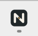

# Issue #25 acceptance

Date: 2026-11-13 (Asia/Shanghai). Implementation: `366633177c5afe6ab74489957b7572b4c2378e8e`. Fixed review baseline: `012af109e3abc999b538ef0003e3e764f6fa888a`.

## Isolation and provenance

All source, assets, captures and builds were produced in this task's dedicated `ea7e/knowledgeGraph` worktree on `codex/issue-25-readme-icon`. The initial detached HEAD was `f72bbf8f27284b600d503178a43628a66ca3e1a1`; merge commit `012af10` integrated only the already committed #23 release baseline `b41614a`. Its sole README conflict was resolved by retaining both the AI networking boundary and the new portable build/cache instructions. No uncommitted file was taken from another checkout. The existing main-checkout client and its data were left running and untouched.

The source screenshot generator and native verifier are committed. Profiles, machine paths, temporary driver sessions and raw full-window captures stay local in ignored directories. Public screenshots contain only synthetic knowledge and a public Docker documentation link. The README uses a direct `.canvas-workspace` element screenshot, excluding the local data path without modifying page styling, injecting facts or simulating IPC.

## Checks and results

| Check | Result |
| --- | --- |
| `npm.cmd ci --prefix app --registry=https://registry.npmjs.org` | Passed; 88 packages, zero reported vulnerabilities. |
| `npm.cmd run typecheck --prefix app` | Passed. |
| `npm.cmd test --prefix app` | Passed: 3 files, 32 existing tests. |
| `node --test app/scripts/release.node-test.mjs` | Passed: 4 existing delivery tests. |
| `cargo fmt --manifest-path app/src-tauri/Cargo.toml --all -- --check` | Passed. |
| Locked/offline Windows x64 Clippy, all targets, `-D warnings` | Passed. |
| Locked/offline Windows x64 `cargo test` | Succeeded; this repository currently has 0 Rust test cases. |
| `./app/build.ps1 -Release -Offline` from implementation commit | Passed; optimized embedded client. |
| Actual EXE save, complete exit, new process, search and read | Passed: all 3 assertions, 2 launches. [Machine-readable result](smoke-result.json). |
| SVG/PNG favicon in the real embedded client | Both returned 200, decoded at 512/32px, and matched the built resource hashes. [Result](display/result.json). |
| Transparent 1024px PNG and size exports | RGBA and transparent corners verified with Pillow. |
| ICO/PE resources | All nine 16/20/24/32/40/48/64/128/256px frames exactly match the source ICO bytes in the EXE. |
| Running native icons | Window owner path verified; `WM_GETICON` returned the new 48px big icon and 256px small-icon source at this host's 150% scale. |
| Visible Windows marks | Actual title bar, actual taskbar and shell-extracted EXE icon visually match the new mark. See images below. |
| Small sizes and background use | Actual 16/32px and 48/128px inspected on light and dark backgrounds. [Size review](icon-size-review.png). |
| README links and language parity | 22 references and 8 sections in each edition checked; local assets/anchors, language switch, official WebView2 and GitHub download/feedback links valid. |
| README layout | Actual Markdown rendered locally; all images loaded, no horizontal overflow, Chinese emphasis corrected. Local preview explicitly identifies itself as a preview, not a GitHub screenshot. |
| Independent review | Standards 0 findings; Spec 0 findings. [Review](review.md). |

The installed `stable` toolchain was verified to be exactly `rustc 1.93.1 (01f6ddf75 2026-02-11)`, matching the pinned repository version. `RUSTUP_TOOLCHAIN=stable` avoided downloading the same compiler again. Cargo dependencies stayed locked: the only lockfile addition is the root package's reference to already-present `windows-sys 0.61.2`.

Final EXE: `app/dist-desktop/noterion.exe`. SHA-256: **`5d2d9d687d4983e70abb544b12acc12d3295f9926c8d6df0da6525b985d222a1`**. This exact file was rebuilt from `3666331`, launched for the final icon/favicon observations and used by the two-launch save/restart smoke. Native resource groups and icon pixels match the earlier screenshot build; its different EXE hash is not represented as the final artifact hash.

## Actual display evidence

These are direct crops of the captured title bar/taskbar, plus the icon extracted by Windows. No mark was painted onto the screenshots. Coordinates, frame hashes, runtime sizes and observation scope are recorded in [display/result.json](display/result.json). The actual client body is [knowledge-graph.png](../../docs/images/knowledge-graph.png); the search state is [knowledge-search.png](../../docs/images/knowledge-search.png).

PrintWindow rendered the native title bar but returned a blank WebView body. That body was not treated as verified by PrintWindow: WebDriver supplied the independent direct client screenshots and real persistence assertions. The native Computer Use plugin declined access to the new EXE; no mouse/keyboard fallback through PowerShell was used. The native verifier only read the specified window/resource handles and bounded taskbar region.

## Discovered and corrected

The first strict native check passed every PE frame but failed on `ICON_BIG`. Actual Tao 0.34.8 source showed that Tauri's window icon sets `ICON_SMALL`, while the taskbar big icon is separate. The Windows helper now loads the same EXE's group 32512 at the window scale and explicitly sets `ICON_BIG`; it uses `LR_SHARED` and does not destroy a Windows-owned handle. A fresh build and process then passed the strict big/small check. This is why replacing a favicon or merely checking icon files was insufficient.

The ordinary sandbox could not install npm dependencies or access Rustup's state. The authorized build/check commands were rerun outside that restriction, with all application output still inside this worktree. No product behavior was changed to accommodate a tool limitation.

## Version and scope limits

The public prerelease remains `0.1.0-main.b41614abef9a`: its real download was hash-verified and it contains local knowledge functionality, without AI or this branding. Both README editions explain this. No new public Release, main-branch merge or license selection is claimed here. Prior live DeepSeek and full media evidence remains linked as prior evidence; this branding change did not repeat paid AI calls or the full large-media suite. Platform delivery is Windows x64, validated on Windows 11; English documentation does not imply an English application UI.
