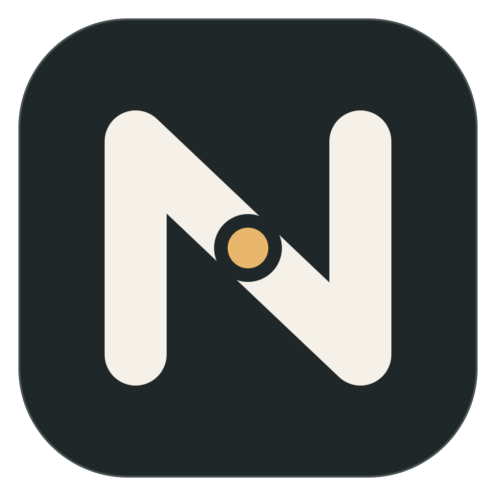
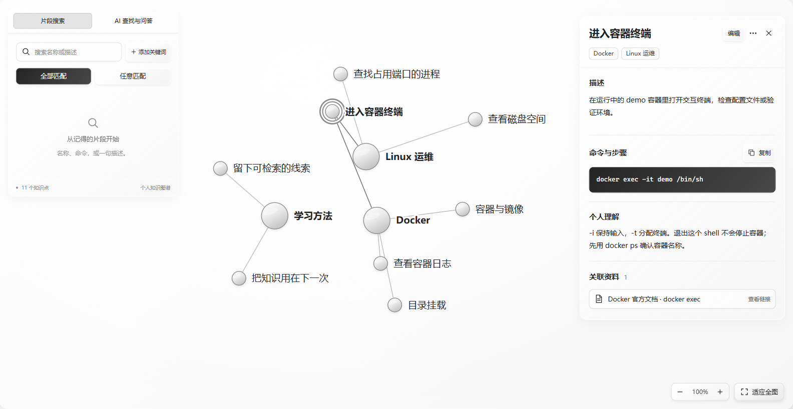

  

<h1 align="center">Noterion</h1>

<strong>Your external brain. A path back to what you have learned.</strong>

Capture it · Find it · Use it

  <a href="README.md">简体中文</a> · English 
  <a href="https://github.com/jking412/Noterion/releases/tag/main-6f44e447be776ac92ec6bc00c90eb19e956e13a1"><strong>Verified download · Windows x64 prerelease</strong></a> ·
  <a href="#quick-start">Quick start</a> ·
  <a href="https://github.com/jking412/Noterion/releases">All releases</a> ·
  <a href="https://github.com/jking412/Noterion/issues">Feedback</a>

Noterion connects knowledge points, your own explanations, and learning materials in a personal knowledge graph. Learned Docker but forgotten the command for entering a container? Search for the clue you remember, find the knowledge point, read your explanation, and open the original material. Put what you learned back to work.

*Captured directly from the workspace of a real Windows client, using demonstration data. The verified download includes the AI search and Q&A entry shown in the screenshot and uses this page's new app icon.*

## From a note to something you can use again

| What you want to do | How Noterion helps |
| --- | --- |
| Capture scattered learning | Save a name, Markdown description, commands, and your own understanding for each knowledge point. Attach a file or web source. |
| Give your knowledge structure | Organize points under topics. A topic is itself a knowledge point; one point can belong to several topics while keeping a single shared copy of its content. |
| Find something from a partial memory | Search names and descriptions, combine keywords, and select a result to locate it in the graph, read its details, and open its sources. |
| Keep the material you learned from | Files are copied into your local data directory, so moving the original does not affect the saved copy. View PDFs, images, and supported video formats in the app. |
| Get help organizing and understanding | Use your configured model to extract knowledge from learning text, retrieve it with natural-language questions, and answer from sources. Review candidates before adopting them, and follow answer citations back to knowledge and materials. |

**Noterion = Note + Orion.** Scattered knowledge resembles stars; your understanding and their connections form a structure you can trace back through. It is designed for personal learning: preserve the conclusion, how you understood it, and where it came from.

## Versions and downloads

The project currently offers a **portable Windows x64 prerelease**. The download above points to a release verified through public download, client operation, and real AI workflows, checked on 2026-11-13.

| Version | Included capabilities |
| --- | --- |
| [Verified prerelease `0.1.0-main.6f44e447be77`](https://github.com/jking412/Noterion/releases/tag/main-6f44e447be776ac92ec6bc00c90eb19e956e13a1) | Local knowledge editing, topics and graph navigation, fragment search, file/link materials, DeepSeek extraction, natural-language retrieval, source-based Q&A, and the new icon. Download and extract the ZIP to run the client; no source build is needed. |
| Historical local-only release `0.1.0-main.b41614abef9a` | Retained for historical reference; includes local knowledge features but not DeepSeek AI or the new icon. |

The [All releases](https://github.com/jking412/Noterion/releases) page lists other builds; check each release's notes for its contents. The [public-package acceptance record](.scratch/product-launch/public-release-validation.md) records downloading the verified package without authentication, icon checks, save/restart checks, and official DeepSeek workflows. The [earlier AI acceptance record](app/validation/ai-acceptance.md) preserves validation of the original implementation. The client interface is currently in Chinese; this README translates the introduction, with actual Chinese control labels retained below. macOS, Linux, and Windows ARM are outside the delivered support scope.

## Quick start

### Download and launch

1. Use a **Windows x64** computer with [Microsoft Edge WebView2 Runtime](https://developer.microsoft.com/microsoft-edge/webview2/) installed. Desktop acceptance was completed on Windows 11 x64.
2. Open the [verified prerelease download page](https://github.com/jking412/Noterion/releases/tag/main-6f44e447be776ac92ec6bc00c90eb19e956e13a1) and download the portable Windows x64 ZIP under **Assets**. The `Source code` archives do not contain a ready-to-run client. You can verify the download against `SHA256SUMS` on the same page.
3. **Extract the entire ZIP into a writable local directory**, then run `noterion.exe`. No database server, Docker, Node.js, or separate background service is needed. The executable is currently unsigned, so Windows may show a trust prompt; verify the download source and checksum first.
4. Check the current data path near the top of the window. To change it, open **数据目录** (Data directory): choose an empty directory for new data, or your original directory for existing knowledge. Selecting a directory does not move or merge its contents.

### Save a knowledge point, then find it again

1. Click **新建知识点** (New knowledge point), enter `Docker`, select **可作为主题组织其他知识点** (Use as a topic), and create it.
2. Create another point named `进入容器终端` (Enter a container shell). Select `Docker` under **所属主题** (Topics), record `docker exec -it demo /bin/sh` in its description, add your explanation, and save.
3. Open **资料库 → 添加资料** (Materials → Add material). Save a tutorial link or local file and associate it with the point. A file is saved as a local copy; an external link is handed to your system browser only when you explicitly open it.
4. Return to **知识图谱** (Knowledge graph), search for `容器终端` in **片段搜索** (Fragment search), and select the result. The graph locates the point so you can read your explanation and open its material.

You can then create a `Linux 运维` (Linux operations) topic and place the same point under both topics. Keep one copy of the content and find it from either direction.

### Configure a model and use AI

Open **模型设置** (Model settings) in the main navigation, choose DeepSeek, OpenAI compatible, or Anthropic compatible, then enter a trusted API root, API key, and full model ID. Save, select **检查连接** (Check connection), and **保存并启用** (Save and activate). All three AI features share the active connection. DeepSeek includes an official preset. Calls require internet access and API credit. The historical prerelease linked above retains its top-bar DeepSeek entry; the three connection types require a build containing Issue #31.

- **知识导入** (Knowledge import): paste ordinary learning notes or read UTF-8 Markdown/TXT. Review the original-text evidence, points, topics, and material associations before adopting the batch.
- **AI 查找与问答 → 查找知识** (AI retrieval and Q&A → Find knowledge): ask from a partial memory, such as “What was that command I learned for entering a container?”, to retrieve your saved knowledge.
- **AI 查找与问答 → 回答问题** (AI retrieval and Q&A → Answer a question): ask and follow up using saved knowledge and explicitly selected text materials. Follow source buttons back to points and materials. General **AI 补充** (AI supplementation) is off by default.

AI retrieval and Q&A do not automatically rewrite knowledge. Extracted candidates become saved knowledge only after you confirm adoption and the local save succeeds. See the [AI guide](app/AI.md) for detailed steps, input limits, and error handling.

## Where your data lives and when it leaves the computer

Your **local SQLite database and file directory** hold your knowledge and materials. The default data directory is `data/` next to the executable: `noterion.sqlite3` stores knowledge and associations, and `files/` stores file copies. The window shows the actual location, and you can select another writable local directory. `%LOCALAPPDATA%/Noterion/directory.json` stores only a pointer to that location, not the knowledge itself; multiple copies of the executable share this setting.

| Operation | Data and network boundary |
| --- | --- |
| Manual editing, graph navigation, fragment search, and saved local materials | Work offline, without a database server or cloud account. In-app video playback depends on the codecs supported by your local WebView2; use a system application if playback fails. |
| AI extraction, retrieval, and Q&A | Require internet access. Rust sends the necessary input text, retrieved knowledge context, material metadata, and explicitly selected text contents to the active model endpoint. It does not upload the whole library by default. |
| API key and connection settings | The key is stored in Windows Credential Manager; model and endpoint settings stay in local configuration. A custom endpoint changes who receives your text and credentials. |
| Original PDFs, images, audio, and video | Can be saved and accessed as materials. OCR, transcription, and automatic extraction of their original contents are not currently provided. |

To make a manual backup, **fully exit the client and copy the entire data directory**. Do not copy only the database while the app is running. Automatic backup/restore, cloud sync, and collaboration are not currently provided. Knowledge deletion shows its impact before confirmation; there is no recycle bin or undo after confirmation.

## Development, contributions, and feedback

The client uses Tauri, Rust, and Vue, with local SQLite and material files as its authoritative storage. Earlier architecture discussions remain in historical documents; the client documentation describes the current implementation.

- [Client source, prerequisites, and build](app/README.md) · [AI usage and implementation](app/AI.md) · [Windows CI and releases](docs/releasing.md)
- [Domain terminology](CONTEXT.md) · [Brand assets and usage](assets/brand/README.md)
- [Report a problem or suggest an improvement](https://github.com/jking412/Noterion/issues): include the client version, reproduction steps, and a sanitized screenshot. Do not submit API keys or your personal knowledge library.
- Before implementing changes, read the [repository collaboration rules](AGENTS.md) and discuss scope in [Issues](https://github.com/jking412/Noterion/issues).

**License:** this repository currently has no LICENSE file and declares no open-source license. Contact the maintainer to confirm permission before using or redistributing source code or brand assets.
