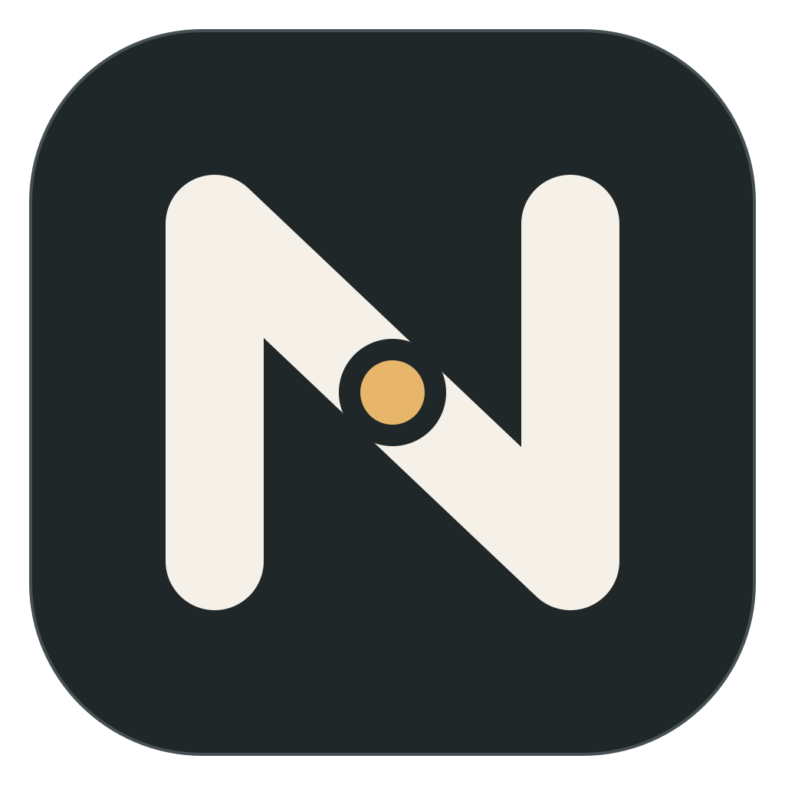
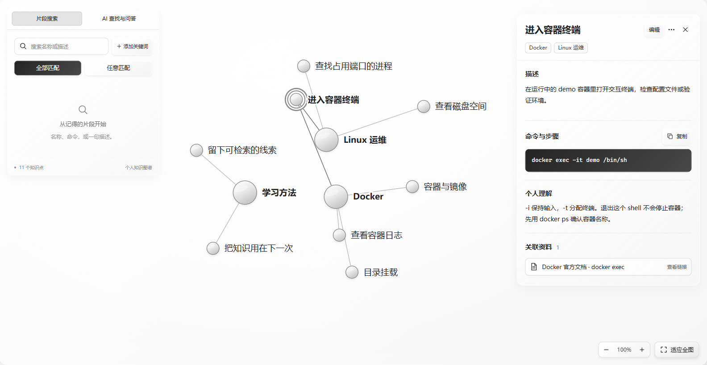

  

<h1 align="center">Noterion</h1>

<strong>个人的外置大脑，让学过的知识循线可寻。</strong>

记下来 · 找回来 · 用起来

  简体中文 · <a href="README.en.md">English</a> 
  <a href="https://github.com/jking412/Noterion/releases/tag/main-6f44e447be776ac92ec6bc00c90eb19e956e13a1"><strong>已验证下载 · Windows x64 预发布</strong></a> ·
  <a href="#快速开始">快速开始</a> ·
  <a href="https://github.com/jking412/Noterion/releases">所有版本</a> ·
  <a href="https://github.com/jking412/Noterion/issues">反馈</a>

Noterion 把知识点、自己的理解和学习资料连接成个人知识图谱。学过 Docker，却忘记进入容器终端的命令？搜索“容器终端”，找到知识点，读回当时记下的说明，再打开原资料，把知识用到眼前的问题上。

*截图直接捕获自真实 Windows 客户端工作区，使用演示数据。推荐下载版已包含图中的 AI 查找与问答入口，并使用本页的新图标。*

## 从记录到再次使用

| 你想做什么 | Noterion 如何帮助你 |
| --- | --- |
| 把零散学习记下来 | 为知识点保存名称、Markdown 描述、命令和个人理解，并关联文件或网页来源。 |
| 给知识建立结构 | 用主题组织知识；主题本身也是知识点。同一个知识点可以属于多个主题，共用同一份内容。 |
| 想起一点线索就能找回 | 按名称或描述片段搜索，组合多个关键词；点击结果定位图谱，阅读详情并打开相关资料。 |
| 留住原来的学习材料 | 文件复制到本机数据目录，源文件后来移动也不影响已保存副本；PDF、图片和支持编码的视频可在应用内查看。 |
| 让 AI 帮忙整理和理解 | DeepSeek 帮助解析学习文本、用自然问题查找知识，并根据来源回答。候选经你核对后采用，问答可沿来源回到知识与资料。 |

**Noterion = Note + Orion（猎户座）。** 分散知识如同星点，理解与联系组成可以循线找回的结构。它为个人学习积累而设计：既留下结论，也留下你当时如何理解、从哪里学到。

## 版本与下载

项目目前提供 **Windows x64 便携预发布版**。上方入口固定指向已完成公开下载、客户端运行和真实 AI 流程验收的版本（核对日期：2026-11-13）。

| 版本 | 已包含的能力 |
| --- | --- |
| [推荐已验证预发布 `0.1.0-main.6f44e447be77`](https://github.com/jking412/Noterion/releases/tag/main-6f44e447be776ac92ec6bc00c90eb19e956e13a1) | 本地知识编辑、主题与图谱、片段搜索、文件及链接资料，以及 DeepSeek 解析、自然语言查找、来源问答和新图标。下载 ZIP 解压即可运行，无需从源码构建。 |
| 历史本地版 `0.1.0-main.b41614abef9a` | 仅作历史版本说明：具备本地知识能力，不含 DeepSeek AI 和新图标。 |

[所有版本](https://github.com/jking412/Noterion/releases)提供其他构建，每个下载包的具体内容以其 Release 说明为准。[公开包验收记录](.scratch/product-launch/public-release-validation.md)记录推荐版的匿名下载、图标、保存重启及官方 DeepSeek 流程验证；[既有 AI 验收记录](app/validation/ai-acceptance.md)保留早期实现的验证依据。当前客户端界面为中文，macOS、Linux 和 Windows ARM 不在已交付支持范围内。

## 快速开始

### 下载并启动

1. 使用 **Windows x64** 电脑，确认已安装 [Microsoft Edge WebView2 Runtime](https://developer.microsoft.com/microsoft-edge/webview2/)。客户端在 Windows 11 x64 上完成验收。
2. 打开[已验证预发布下载页](https://github.com/jking412/Noterion/releases/tag/main-6f44e447be776ac92ec6bc00c90eb19e956e13a1)，从 **Assets** 下载 Windows x64 的便携 ZIP；`Source code` 压缩包不含可直接运行的程序。可使用同页 `SHA256SUMS` 核对文件。
3. 将 ZIP **完整解压到本机可写目录**，双击 `noterion.exe`。程序无需安装数据库、Docker、Node.js 或独立后台服务。当前程序未签名，Windows 可能显示信任提示；请先核对下载来源与校验值。
4. 查看窗口顶部显示的当前数据路径。需要更换时，打开 **数据目录**：新建请选择空目录，已有知识请选择原数据目录。切换目录不会自动搬迁或合并数据。

### 保存第一个知识，再把它找回来

1. 点击 **新建知识点**，名称填写 `Docker`，勾选 **可作为主题组织其他知识点**，创建知识点。
2. 再建一个知识点 `进入容器终端`，在 **所属主题** 中选择 `Docker`，在描述中记录 `docker exec -it demo /bin/sh`，补上自己的解释并保存。
3. 在 **资料库 → 添加资料** 中保存教程链接或本机文件，关联到这个知识点。文件将保存为本机副本；外部链接在你明确打开时交给系统浏览器。
4. 回到 **知识图谱**，在 **片段搜索** 中搜索 `容器终端`，点击结果。图谱会定位该知识点，你可以读回说明并打开关联资料。

之后可新建 `Linux 运维` 主题，把同一个 `进入容器终端` 同时归入两个主题。无需复制内容，下次从任一主题都能找到它。

### 使用 DeepSeek

点击顶部 **DeepSeek**，填写自己的 API key，保存并 **检查连接**。默认接入官方 DeepSeek，调用需要联网和可用的 API 额度。

- **知识导入**：粘贴普通学习笔记或读取 UTF-8 Markdown/TXT，解析后核对原文依据、知识点、所属主题和资料关联，再整批采用。
- **AI 查找与问答 → 查找知识**：输入“之前学过怎么进入容器，命令是什么？”这类模糊记忆，让 AI 检索本机已有知识。
- **AI 查找与问答 → 回答问题**：根据已保存知识及明确选中的文本资料回答并追问，通过来源按钮回到知识与资料。通用 **AI 补充**默认关闭。

AI 搜索和问答不会自动改写知识；解析候选只有在你确认采用且保存成功后才成为正式知识。详细步骤、输入限制和失败处理见 [AI 使用说明](app/AI.md)。

## 数据留在哪里，哪些操作需要联网

知识和资料由你电脑上的 **SQLite 数据库与文件目录**保存。默认数据目录是程序旁的 `data/`，其中 `noterion.sqlite3` 保存知识及关联，`files/` 保存文件副本；窗口显示实际使用的位置。你可以选择其他本机可写目录。`%LOCALAPPDATA%/Noterion/directory.json` 只记录数据位置指针，并不保存知识本体；多个程序副本共享此位置设置。

| 操作 | 数据与网络边界 |
| --- | --- |
| 手工编辑、图谱、片段搜索、读取已保存的本机资料 | 可离线使用，无需数据库服务器或云端账户。视频能否内置播放取决于本机 WebView2 支持的编码，失败时可使用系统应用打开。 |
| AI 解析、检索与问答 | 需要联网。Rust 将本次必要的输入文本、检索到的知识上下文、资料元信息及明确选中的文本内容发送到配置的 DeepSeek 接入地址；不默认上传整库。 |
| AI key 与接入配置 | 密钥保存在 Windows Credential Manager，模型和地址保存在本机配置中。自定义接入地址会改变文本和凭据的接收方。 |
| 原始 PDF、图片、音视频 | 可作为资料保存和查看；当前不提供 OCR、音视频转写或自动提取原文件正文。 |

如需手工备份，**完全退出客户端后复制整个数据目录**，不要只复制运行中的数据库文件。当前不提供自动备份恢复、云同步或多人协作。删除知识点前会展示影响范围；没有回收站，确认删除后无法撤销。

## 开发、贡献与反馈

客户端采用 Tauri、Rust 与 Vue，正式数据源是本机 SQLite 和资料文件。旧架构讨论保留在历史文档中，当前实现以客户端说明为准。

- [客户端源码、环境与构建](app/README.md) · [AI 使用与实现](app/AI.md) · [Windows CI 与发布](docs/releasing.md)
- [领域术语](CONTEXT.md) · [品牌素材与使用说明](assets/brand/README.md)
- [报告问题或提出建议](https://github.com/jking412/Noterion/issues)：附上程序版本、复现步骤和脱敏截图即可，请勿提交 API key 或个人知识库。
- 参与实现前，请阅读 [仓库协作规则](AGENTS.md)，并在 [Issues](https://github.com/jking412/Noterion/issues) 中沟通范围。

**许可证：** 目前仓库未提供 LICENSE 文件，尚未声明开源许可；使用或分发源码及品牌素材前，请先与维护者确认授权。
