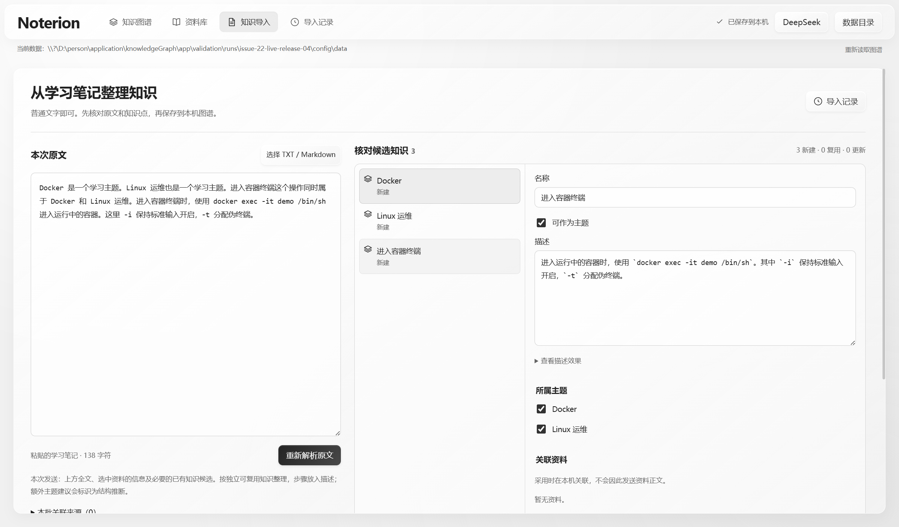
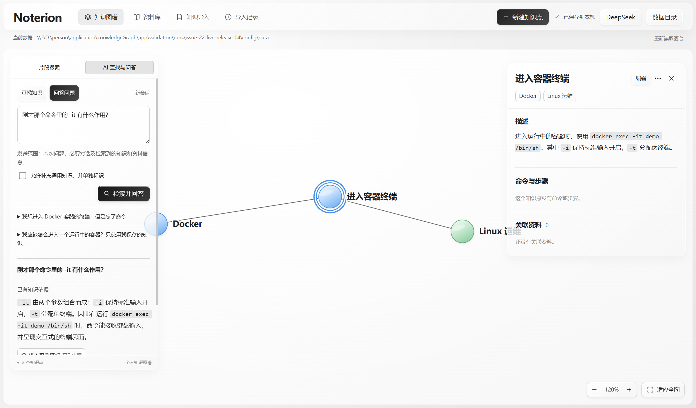

# Issue #22：DeepSeek AI Native 验收

日期：2026-11-13（Asia/Shanghai）。结论：自动解析、自动搜索与来源问答已在真实 Windows Tauri 客户端交付，官方 DeepSeek 正常流程通过，既有本地能力回归通过。真实模型、模拟错误和本地回归分开记录，不把预期失败当成官方服务失败，也不以模拟响应代替真实调用。

## 交付程序

- 优化版：`app/dist-desktop/noterion.exe`，12,653,056 字节。
- 分发包：`app/dist-desktop/Noterion-Windows-x64-AI.zip`，仅含同一程序、README.md 和 AI.md。
- 程序 SHA-256：`74F0A08225CA2C6ECF8CD08BFB79035A2A9549D992EDB6218FCD601499D13B4F`。
- 分发包 SHA-256：`BF4AE92A655740CE17EBFCF2D38D03FE6F2F7CF5E9CA95A9ECC65D6E7330B58C`。

已独立读取 ZIP 内程序并核对其哈希与验收程序相同。发行包不包含测试密钥、用户数据、测试配置或 WebView profile。需要 Windows x64 与已安装的 WebView2 Runtime，使用和边界见 [AI 使用说明](../AI.md)。

## 最终运行结果

所有业务输入、点击、采用、来源跳转和删除均通过可见桌面界面执行；JavaScript 仅只读观察。每次运行使用独立配置、数据和 profile。完整机器可读汇总见 [ai-final-summary.json](ai-final-summary.json)。

| 运行 | 类型 | 结果 | 覆盖 |
| --- | --- | --- | --- |
| `issue-22-live-release-04` | 官方 DeepSeek、优化版 | 6 项 PASS | 配置及真实连接检查、自然文本提取、整批采用并重启、自然语言定位、来源回答与追问、完全重复输入 |
| `issue-22-faults-debug-06` | 本机供应商夹具、调试版 | 29 项 PASS | 未配置、空白、截断、非法字段/颜色/身份/依据/主题/循环、鉴权、限流、服务错误、原生断连、一次受限修正、取消、配置回滚、采用及原记录更新、非法引用、分段 |
| `issue-22-resources-debug-02` | 本机供应商夹具、真实资料流程 | 7 项 PASS | Markdown 副本、来源读取/关联、允许文本问答、来源跳转、删除保留资料、重复不复活、链接只作关联 |
| `issue-22-feedback-green-02` | 真实界面回归 | 2 项 PASS | AI 入口、采用失败清除上一笔本地成功提示 |
| `issue-22-migration-release-02` | 旧版→优化版 | 1 项 PASS | 用已分发 v1 程序实际创建知识，再由新客户端打开并保留 |
| `issue-21-ai22-regression-release-02` | 优化版、本地完整回归 | 39 项 PASS，10 次启动 | 原知识、主题、图谱交互、资料、媒体、删除、目录、权限/锁/空间等故障 |

主要结果与断言已保留在 [ai-evidence](ai-evidence/)：

- [官方正常流程断言](ai-evidence/live-release-checks.json)与[结果](ai-evidence/live-release-result.json)。
- [模拟异常断言](ai-evidence/faults-debug-checks.json)与[脱敏请求统计](ai-evidence/faults-provider-metadata.json)。统计不包含请求头、密钥或完整正文。
- [资料流程断言](ai-evidence/resources-debug-checks.json)与[供应商请求统计](ai-evidence/resource-provider-metadata.json)。重复资料在本机命中后，供应商请求数量保持不变。
- [既有本地能力断言](ai-evidence/local-regression-checks.json)与[结果](ai-evidence/local-regression-result.json)。

原始会话和截图位于 `app/validation/runs/<run>/`，既有本地回归位于 `app/validation/evidence/issue-21-ai22-regression-release-02/`；这些隔离目录不随源码或发行包分发。

## 真实模型与采用契约

官方正常运行明确使用 `https://api.deepseek.com` 和 `deepseek-flash`，没有连接本机夹具。输入是普通学习文本，包含 Docker、Linux 运维、进入容器终端及 `docker exec -it demo /bin/sh` 的解释，没有固定字段或用户维护的内部标识。

程序展示候选及逐字原文依据，用户采用后，重启可在正式图谱和描述中找到同一知识。模糊提问没有提供 `docker exec` 仍定位真实知识；回答与 `-it` 追问引用实际已有描述，来源按钮可跳回图谱。完全相同的输入通过持久采用回执直接识别，不再次请求模型、不重复创建知识，也不会恢复后来删除的知识。

非法关系在正式事务前被拒绝，修正后可以整批采用。新点统一分配身份并映射批内/已有引用；同名新建保持独立，复用和更新由用户明确选择。原记录更新保持记录身份，输入省略不撤回旧知识或关联。事务、记录和采用回执共同提交，未采用的候选不会成为正式事实。

## 调试过程中实际发现并修复的问题

用户观察到的失败并非全部都是故障注入，真实路径曾发现以下问题，均已修复后复核：

1. **主题角色错误。** 模型曾将参数拆为子点，却把父操作保留为 `isTheme=false`。程序正确拒绝但最初反馈过于笼统。现提示词明确主题是组织角色、参数步骤默认留在描述，业务错误指出涉及的知识名称，并进入同一预算的一次模型修正；程序不自动改布尔值或放宽循环/引用校验。
2. **重复输入重新调用模型。** 模型可能对已整理内容返回空候选。现先查持久化输入指纹，返回本机已有采用记录，再由服务器核对结果，完全跳过模型提取。
3. **采用选择和工作区状态。** 修复了复用切回新建时残留目标，以及“整理新文本”误沿用旧原记录草案的问题。
4. **配置和反馈一致性。** 配置替换失败恢复原系统凭据；失败后不残留上一笔成功提示。真实文件共享锁和可失败的界面回归已验证。

另有自动化本身的失败记录：早期并行桌面运行出现 WebDriver 会话断开，改为顺序独立运行后完整 39 项通过；设置字段尚未加载时自动填写曾拼接出错误地址，现等待设置就绪并只读核对实际输入；长文输入脚本曾超时，最终用明确超过 12,000 字节分段阈值的文本完成分段验证。失败运行保留在原始目录，未计入最终通过结果。

## 本地与媒体观察

旧版 v1 程序来自原分发包，SHA-256 为 `0DD5E4697A38A1B23B7EA5DCACE9545757D0195B5822B6C0E4E9E08DE39D5207`。升级只新增同库记录/回执表，不重建 Point 或资料副本。

本地回归包含真实 1.28 GB 视频起播、解码、远处拖动和继续播放，Range 字节及越界处理、完整流哈希与取消读取；不支持的编码明确失败并保留系统应用打开。PDF 截图已实际查看，工具栏、1/1 页码及正文 checklist 可见，见 [PDF 正文证据](ai-evidence/local-pdf.png)。不是仅根据 iframe 或 load 事件判定成功。

WebView 的 HTTP/HTTPS 代理隔离只证明该 WebView 会话远程网络不可用，不等于 OS 或 Rust 网络整体被隔离。原生 Rust 请求中断由另一个供应商断连夹具真实验证，不混用这两类证据。

## 检查、审查与范围

最终 `vue-tsc`、Vite 和 Rust 优化构建通过；`npm test` 为 3 个文件、32 条通过；Rust 格式和补丁检查通过。Standards / Spec 初审发现已修复并复核，未解决 P2 为 0，保留一项非阻断的状态字符串枚举化建议，见 [审查记录](ai-review.md)。

本次不包含 PDF/OCR/音视频转文本、互联网检索、向量库、外部数据库或业务后台。长文跨段候选仍需用户核对关系和重复内容；来源存在性校验不能证明模型对证据的理解永远正确，采用前的核对继续保留。未声称已验证其他 Windows 机器、全部媒体编码或未约定的容量/延迟门槛。

